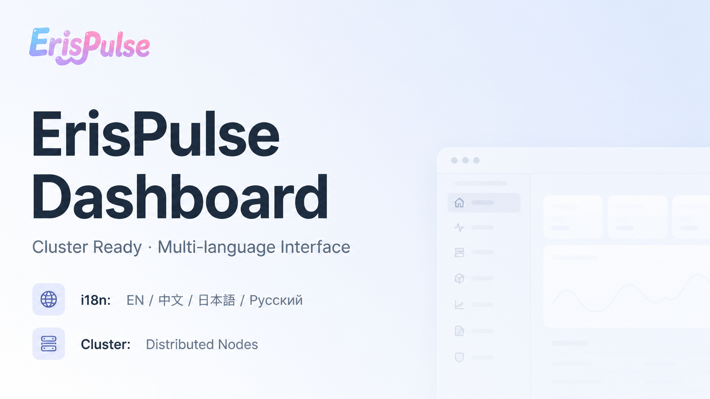

<div align="center">




# ErisPulse Dashboard

**ErisPulse 官方 Web 管理面板模块**

[](https://pypi.org/project/ErisPulse-Dashboard/)

[English](README.md) | **简体中文** | [繁體中文](README.zh-TW.md) | [日本語](README.ja.md) | [Русский](README.ru.md)

</div>

---

## 简介

**不用命令行，也能管好一个 bot。** 机器人挂在服务器上运行之后，看状态、开关模块、改配置、翻事件日志、清理数据这些日常操作，都可以在浏览器面板里完成。

先在线体验：**[dashdemo.erisdev.com](https://dashdemo.erisdev.com)**。演示站以模拟数据呈现完整面板，进入时 Token 填 `demo`，每个页面都可以实际点开操作。

## 面板里有什么

### 掌握运行状态

- **系统概览** — 框架版本、运行时间、适配器与模块状态一目了然
- **事件流** — 实时查看框架产生的事件，默认保留最近 500 条（`max_event_log` 可调）
- **Bot 管理** — 查看所有平台的 Bot 连接状态与信息
- **拓扑图谱** — 可视化模块 / 适配器 / Bot 及其资源与作用域的归属连线关系（需 ErisPulse 2.8.0+）
- **集群管理** — 多节点集群监控与管理

### 管理模块与权限

- **模块管理** — 启用、禁用、加载模块与适配器
- **插件商店** — 浏览远程包仓库，在线安装依赖包
- **主人系统** — 管理框架主人，支持全局或按平台设置权限，展示身份源 Provider 归属
- **作用域管理** — 三维控制面（模块绑定 / 身份准入 / 出站限制）、全局兜底开关、运行统计、运行时绑定归属权管理与判定测试器（需 ErisPulse 2.8.0+）
- **命令管理** — 命令规则编辑，支持归属模块展示、ACL 用户黑白名单、参数覆写（master / hidden）与命令转换

### 调整配置与数据

- **配置编辑** — 运行时查看与修改框架配置
- **存储管理** — 查看、编辑、删除持久化存储的键值数据

### 日常运维

- **远程重启** — 通过 Web 界面安全重启框架
- **统一 UI 组件** — 自定义下拉与可搜索多选替代原生控件，且保持向后兼容

## 安装

```bash
pip install ErisPulse-Dashboard

# 国内镜像
pip install -i https://pypi.tuna.tsinghua.edu.cn/simple ErisPulse-Dashboard
```

安装后模块将被 ErisPulse 框架自动发现并加载。面板前端资源内置于 pip 包中，开箱即用，不依赖任何外部前端构建工具。

## 访问地址

安装并启动 ErisPulse 框架后，在浏览器中打开：

```
http://<host>:<port>/Dashboard/
```

其中 `<host>` 和 `<port>` 为 ErisPulse 框架的监听地址与端口。

## 认证

模块首次加载时会自动生成一个访问 Token，并输出到框架日志中：

```
[Dashboard] ╔══════════════════════════════════════════════╗
[Dashboard] ║           ErisPulse Dashboard                ║
[Dashboard] ║  访问地址: /Dashboard                       ║
[Dashboard] ║  访问令牌: <your-token-here>                 ║
[Dashboard] ║  令牌已保存至配置文件 Dashboard.token         ║
[Dashboard] ╚══════════════════════════════════════════════╝
```

为避免令牌泄露，仅在首次生成时在日志中明文输出。

打开 Dashboard 时需输入该 Token 完成认证。您也可以在配置文件中预设 Token：

```toml
[Dashboard]
token = "your-custom-token"
title = "ErisPulse Dashboard"
max_event_log = 500
```

## 配置项

| 配置键 | 类型 | 默认值 | 说明 |
|--------|------|--------|------|
| `Dashboard.title` | `str` | `"ErisPulse Dashboard"` | 面板标题 |
| `Dashboard.max_event_log` | `int` | `500` | 事件日志最大保留条数 |
| `Dashboard.token` | `str` | 自动生成 | 访问 Token |

## 下一步

- **想先试用** → 打开[在线演示](https://dashdemo.erisdev.com)，Token 输入 `demo`
- **想部署** → 到 [erisdev.com](https://www.erisdev.com) 阅读 ErisPulse 安装与部署文档，再回到上方「安装」一节装上面板
- **想提需求 / 报问题** → 到 [Issues](https://github.com/ErisPulse/ErisPulse-Dashboard/issues) 告诉我们

## 许可证

MIT

## 字体归属 / Font Attribution

Dashboard 默认使用系统字体栈（覆盖中/繁/日/俄/英全部界面语言，零外部请求）。

用户可在 **设置 → 外观** 中上传自定义字体（`.ttf` / `.otf` / `.woff` / `.woff2`，≤15MB）自由替换界面字体；上传的字体保存在服务端 `static/res/fonts_upload/`，可随全局同步分发到所有设备。

字体文件的版权归各自作者所有，使用上传功能时请确认你拥有相应字体的合法授权。
