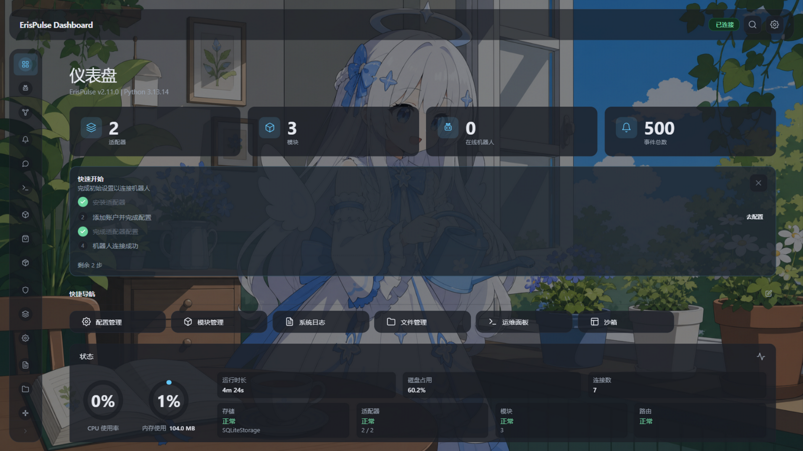
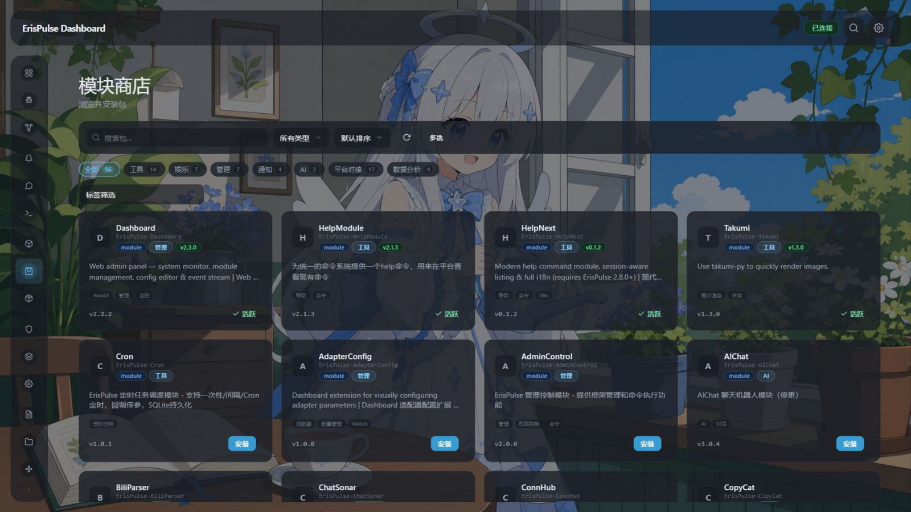
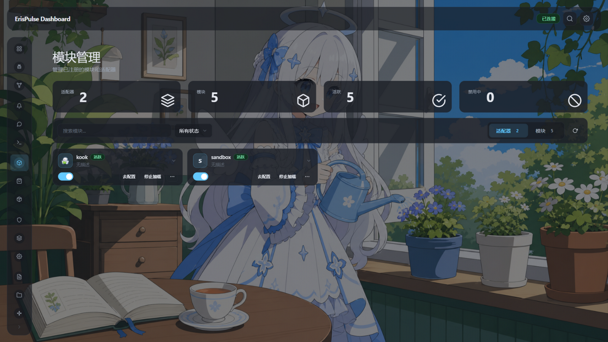
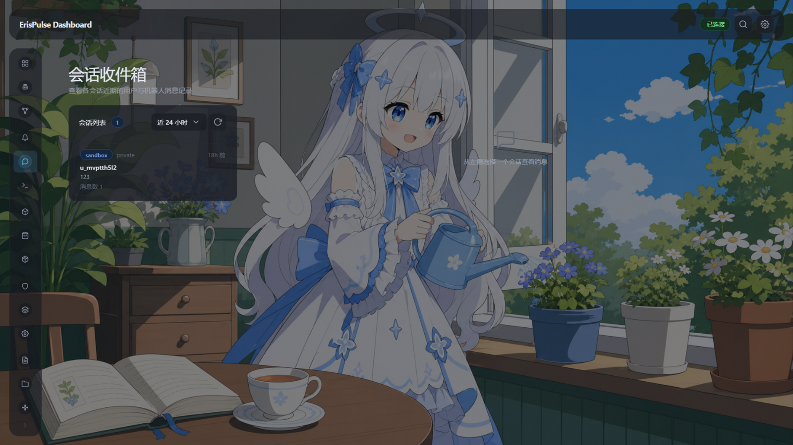
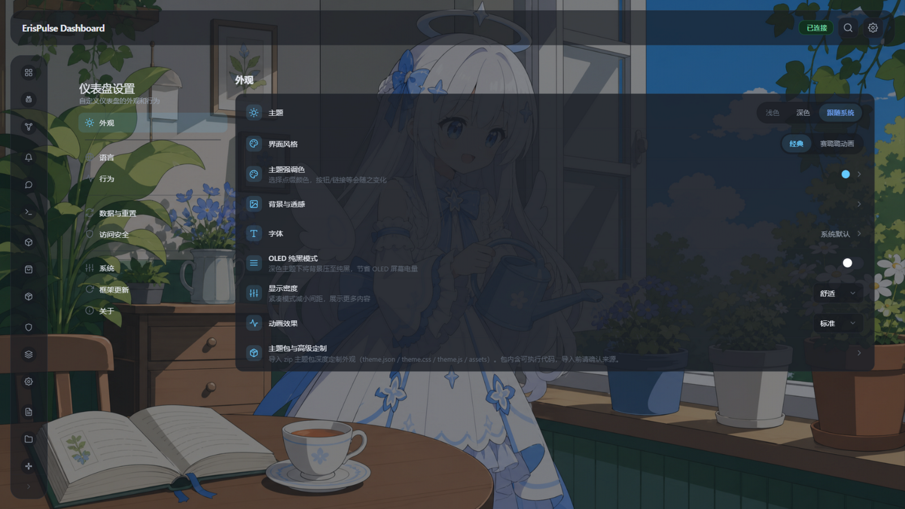
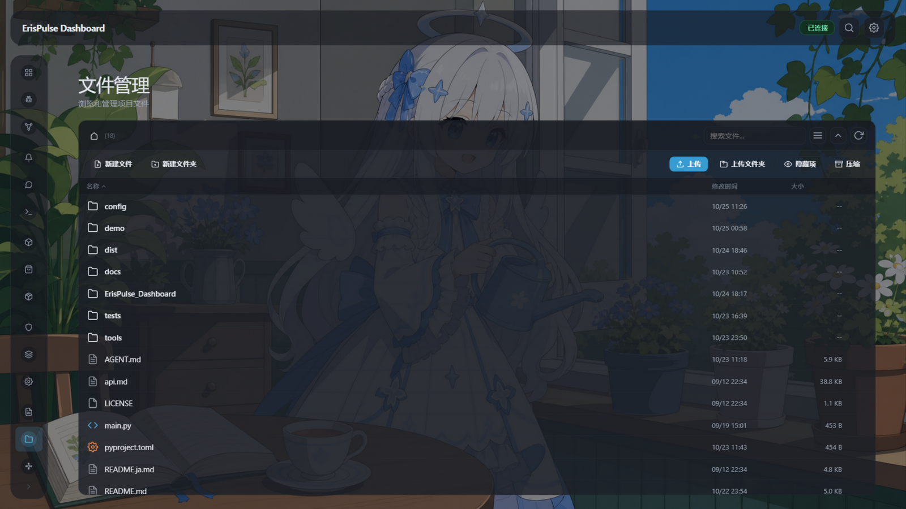
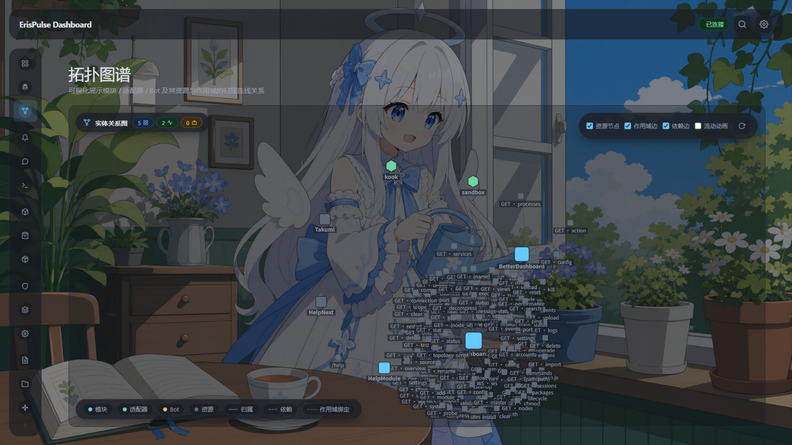

<div align="center">


# ErisPulse Dashboard

**Модуль веб-панели управления ErisPulse**

[](https://pypi.org/project/ErisPulse-Dashboard/)

[English](README.md) | [简体中文](README.zh-CN.md) | [繁體中文](README.zh-TW.md) | [日本語](README.ja.md) | **Русский**

</div>

---

## Скриншоты

| | |
|---|---|
| **Панель управления** | **Магазин модулей** |
|  |  |
| **Управление модулями** | **Входящие диалогов** |
|  |  |
| **Настройки** | **Файловый менеджер** |
|  |  |
| **Карта топологии** | |
|  | |

> На скриншотах — пользовательский фон и акцентный цвет; внешний вид полностью настраивается.


## Обзор

ErisPulse Dashboard — официальная веб-панель управления для ErisPulse: после того как бот развернут на сервере, просмотр статуса, управление модулями, правка конфигурации и журналов делаются прямо в браузере, без командной строки.

Онлайн-демо: [dashdemo.erisdev.com](https://dashdemo.erisdev.com) (токен — `demo`, данные демонстрационные, можно кликать везде).

## Возможности

**Мониторинг**

- Обзор системы: версия фреймворка, время работы, CPU / память, состояние хранилища и соединений
- Поток событий: события и сообщения в реальном времени, фильтры, поиск, конструктор событий
- Карта топологии: связи модулей / адаптеров / ботов и ресурсов, перетаскивание и зум
- Управление ботами: статус подключения на каждой платформе

**Управление**

- Модули и адаптеры: запуск, остановка, перезагрузка, настройки; поддержка теневого тестирования
- Магазин модулей: онлайн-установка, массовый выбор
- Менеджер пакетов: обновление и удаление pip-пакетов, установка из whl
- Права доступа: список владельцев и трёхмерные скоупы (модуль / личность / исходящие)
- Управление командами: правила, алиасы, переопределение параметров

**Данные и обслуживание**

- Входящие диалогов: недавние сообщения пользователей и бота (нужен ErisPulse 2.11.0+)
- Просмотр хранилища: KV-данные и таблицы базы — просмотр и очистка
- Файлы: редактирование кода онлайн, превью картинок и видео
- Журналы: логи в реальном времени, события жизненного цикла, аудит, export
- Кластер: подключение удалённых узлов

## Внешний вид и мобильные устройства

Тёмная / светлая / OLED-чёрная тема, аниме-скин cel shading, 8 акцентных цветов, замена фоновой картинки (интерфейс становится полупрозрачным и уступает место фону), загрузка своих шрифтов, десктопные уведомления. Настройки синхронизируются между устройствами. В мобильном браузере тоже всё работает.

## Установка

```bash
pip install ErisPulse-Dashboard

# Зеркало в Китае
pip install -i https://pypi.tuna.tsinghua.edu.cn/simple ErisPulse-Dashboard
```

После установки модуль будет автоматически обнаружен и загружен фреймворком ErisPulse.

## URL доступа

После установки и запуска фреймворка ErisPulse откройте в браузере:

```
http://<host>:<port>/Dashboard/
```

Где `<host>` и `<port>` — адрес и порт прослушивания фреймворка ErisPulse.

## Аутентификация

Модуль автоматически генерирует токен доступа при первой загрузке и выводит его в журнале фреймворка:

```
[Dashboard] ╔══════════════════════════════════════════════╗
[Dashboard] ║           ErisPulse Dashboard                ║
[Dashboard] ║  URL: /Dashboard                             ║
[Dashboard] ║  Токен: <your-token-here>                    ║
[Dashboard] ║  Токен сохранён в конфиг: Dashboard.token     ║
[Dashboard] ╚══════════════════════════════════════════════╝
```

Во избежание утечки токен отображается в открытом виде только при первом создании.

Введите этот токен при открытии Dashboard для аутентификации. Вы также можете предварительно задать токен в файле конфигурации:

```toml
[Dashboard]
token = "your-custom-token"
title = "ErisPulse Dashboard"
max_event_log = 500
```

## Параметры конфигурации

| Ключ | Тип | По умолчанию | Описание |
|------|-----|-------------|----------|
| `Dashboard.title` | `str` | `"ErisPulse Dashboard"` | Заголовок панели |
| `Dashboard.max_event_log` | `int` | `500` | Максимальное количество записей журнала событий |
| `Dashboard.token` | `str` | Авто-генерация | Токен доступа |

## Лицензия

MIT
